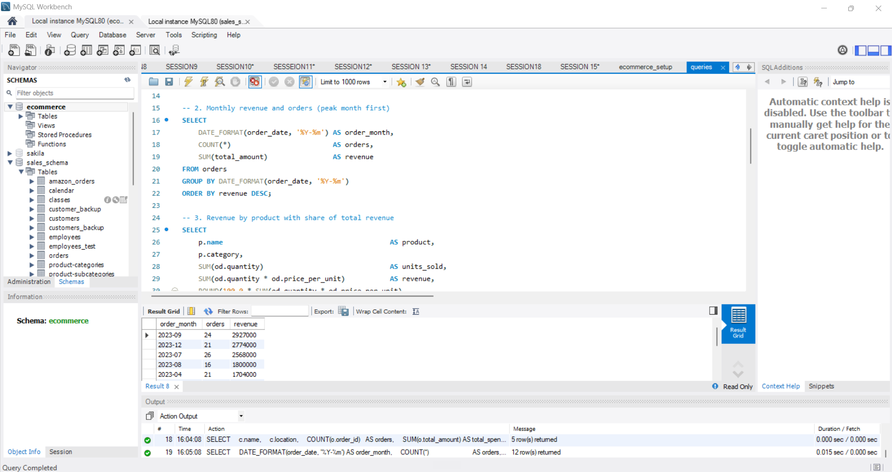

# E-Commerce Sales Analysis (SQL)

SQL analysis of 200 orders from 100 customers across 8 products
(March 2023 to February 2024).

## Tools Used
- SQL (MySQL): joins, aggregations, subqueries, CTEs

## Tables
products, customers, orders, orderdetails

## Analysis
- Business overview: orders, revenue and average order value
- Monthly revenue and orders
- Revenue by product and by category
- City performance
- Repeat customers
- Top customers by spend

## Key Findings
- Total revenue Rs.1.98 Cr; average order value about Rs.99K.
- September 2023 was the peak month (Rs.29.27L, 24 orders),
  followed
